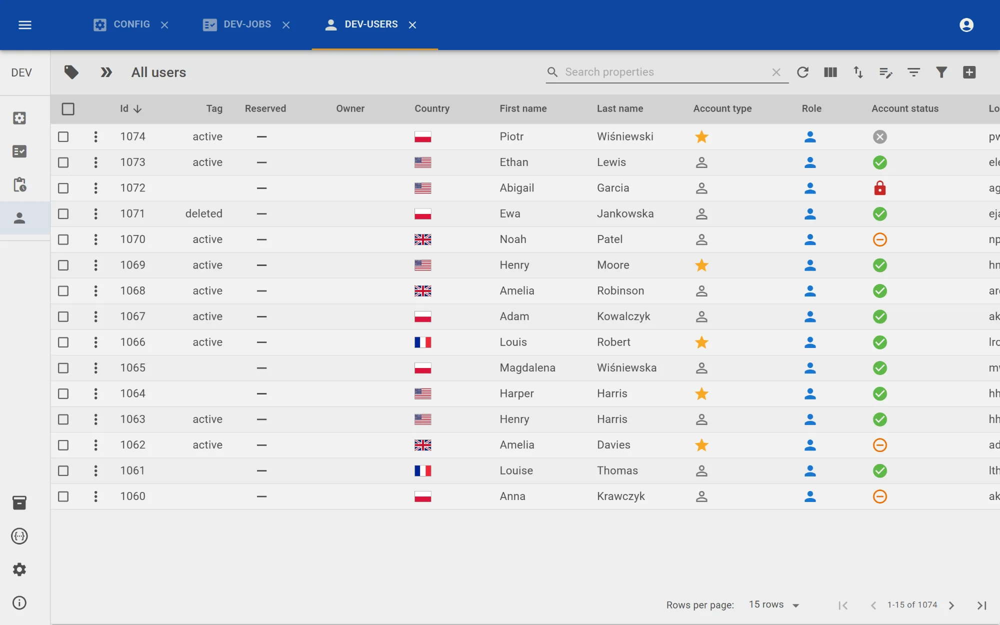
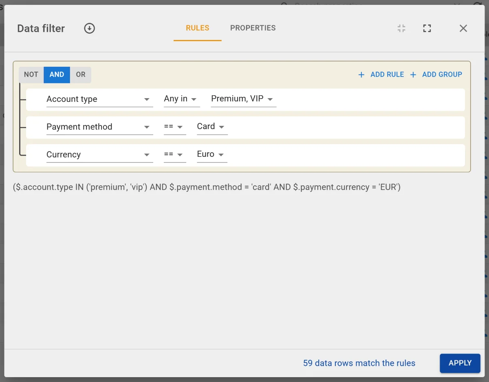
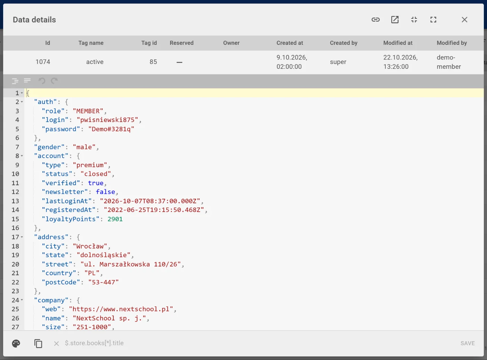
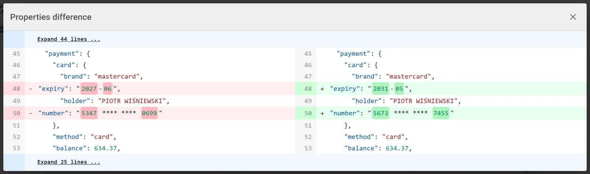
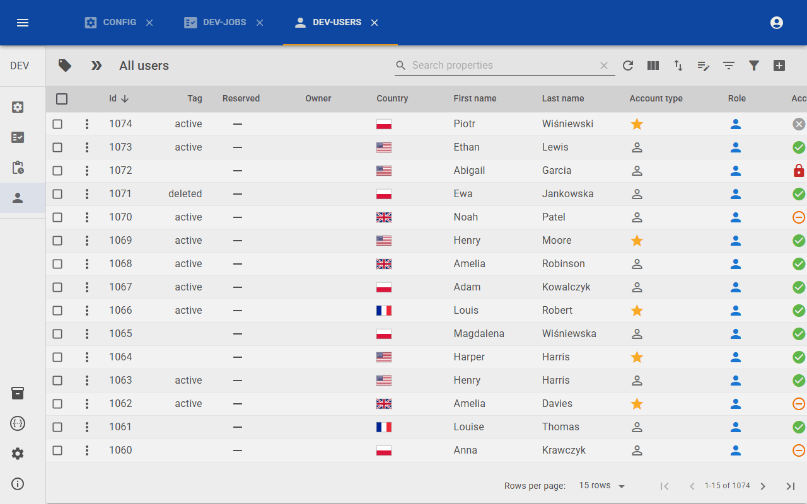

<pre>
    ██████╗  █████╗ ████████╗ █████╗ ██████╗ ██╗   ██╗ ██████╗██╗  ██╗███████╗████████╗
    ██╔══██╗██╔══██╗╚══██╔══╝██╔══██╗██╔══██╗██║   ██║██╔════╝██║ ██╔╝██╔════╝╚══██╔══╝
    ██║  ██║███████║   ██║   ███████║██████╔╝██║   ██║██║     █████╔╝ █████╗     ██║
    ██║  ██║██╔══██║   ██║   ██╔══██║██╔══██╗██║   ██║██║     ██╔═██╗ ██╔══╝     ██║
    ██████╔╝██║  ██║   ██║   ██║  ██║██████╔╝╚██████╔╝╚██████╗██║  ██╗███████╗   ██║
    ╚═════╝ ╚═╝  ╚═╝   ╚═╝   ╚═╝  ╚═╝╚═════╝  ╚═════╝  ╚═════╝╚═╝  ╚═╝╚══════╝   ╚═╝
</pre>

# About project

**Databucket** is an Open Source Test Data Management Tool. It delivers features to effectively create and maintain test data and metadata for extensive tests on multiple projects, environments, and various integrated tools at the same time. Databucket stores data in elastic structures, which gives a ready approach to maintain constantly changing test data in the software development process.

* **No more data collisions** – tests reserve records through the REST API, each record goes to one test at a time.
* **Flexible data buckets** – data of any shape as JSON, per project, environment and team.
* **Full history and audit** – who changed what and when, with a side-by-side diff.
* **Find the right data fast** – tags, saved filters, a visual rule builder and views, also on nested JSON.
* **Self-hosted** – a single jar and PostgreSQL, single sign-on (OpenID Connect), roles and robot accounts for CI.

<picture>
  <source srcset="docs/screens/data-table-dark.webp" media="(prefers-color-scheme: dark)">
  
</picture>

| Visual rule builder | Data details |
|---|---|
| <picture><source srcset="docs/screens/rich-filter-dark.webp" media="(prefers-color-scheme: dark)"></picture> | <picture><source srcset="docs/screens/data-details-dark.webp" media="(prefers-color-scheme: dark)"></picture> |
| **History diff** | **Reserving data** |
| <picture><source srcset="docs/screens/history-diff-dark.webp" media="(prefers-color-scheme: dark)"></picture> | <picture><source srcset="docs/screens/reserve-flow-dark.gif" media="(prefers-color-scheme: dark)"></picture> |

The screenshots show the DEMO dataset that comes with Databucket (Management → Projects → Import dataset).

# Getting started with Databucket
* First you can read about key features on [databucket.pl](https://databucket.pl)
* Try it with Docker: `cd docker && docker compose up --build`, open http://databucket.localhost, sign in as `super` / `super` and import the DEMO dataset in Management → Projects.
* Next, you can dive deeper in the [Wiki page](https://github.com/databucket/databucket-server/wiki).

# Upgrading
New tables and columns are added automatically on startup. Changes that can't be done that way come
as SQL scripts in [`upgrade/`](upgrade), named after the version that needs them. When upgrading an
existing database, run the scripts of the versions you skip, in order, e.g.:

```
psql -h <host> -U <user> -d <database> -f upgrade/3.7.0.sql
```

* **3.7.0** — user emails must be unique (single sign-on matches users by email). The script normalizes
  the emails and adds the unique constraint; when several users share an email it lists them and changes nothing.
* **3.7.3** — indexes on the tables of existing buckets (data by tag and reservation, history by data row) and
  the tag of a history entry as bigint. Run it while Databucket is stopped: changing the type rewrites the history tables.

# Contribution rules

1. During development, we are following GitHub flow. In order to provide change or fix in project, one has to:

    1. Create a branch from the repository.
    2. Create, edit, rename, move, or delete files.
    3. Send a pull request from your branch with your proposed changes to kick off a discussion.
    4. Make changes on your branch as needed. Your pull request will update automatically.
    5. Merge the pull request once the branch is ready to be merged.
    6. Tidy up your branches using the delete button in the pull request or on the branches page.

   For more information see [Understanding the GitHub flow](https://guides.github.com/introduction/flow/).

2. Each commit must contain clear and descriptive commit messages.

3. Source code must be properly formatted

   [//]: # (TODO add more info once formatter is defined and added to the code)

4. Source code must be checked according to checkstyle rules

   [//]: # (TODO add more info once formatter is defined and added to the code)

5. Changes must be well-tested. See also **Testing strategy** chapter.

# Setup

# Prerequisites

Installed below dependencies:

- Java 17
- NodeJS 22 — only for the Vite dev server (`npm run dev`). The Gradle build downloads its own Node.js.

To try Databucket without installing anything but Docker, `docker/docker-compose.yaml` starts it together with
PostgreSQL and Keycloak (single sign-on): `cd docker && docker compose up --build`, then open http://databucket.localhost.

## Useful commands

| command                                                  | what it does                                                                            |
|----------------------------------------------------------|-----------------------------------------------------------------------------------------| 
| `./gradlew clean assemble`                               | compiles java classes                                                                   |
| `./gradlew test`                                         | runs all tests                                                                          |
| `./gradlew buildFrontend`                                | installs frontend dependencies and builds frontend                                      |
| `./gradlew copyFrontend`                                 | `buildFrontend` and copies frontend file to java resources                              |
| `export SPRING_PROFILES_ACTIVE=dev && ./gradlew bootRun` | starts app with dev profile                                                             |
| `./gradlew clean build`                                  | compiles java classes, builds frontend, runs tests and prepares all-in-one runnable jar |


